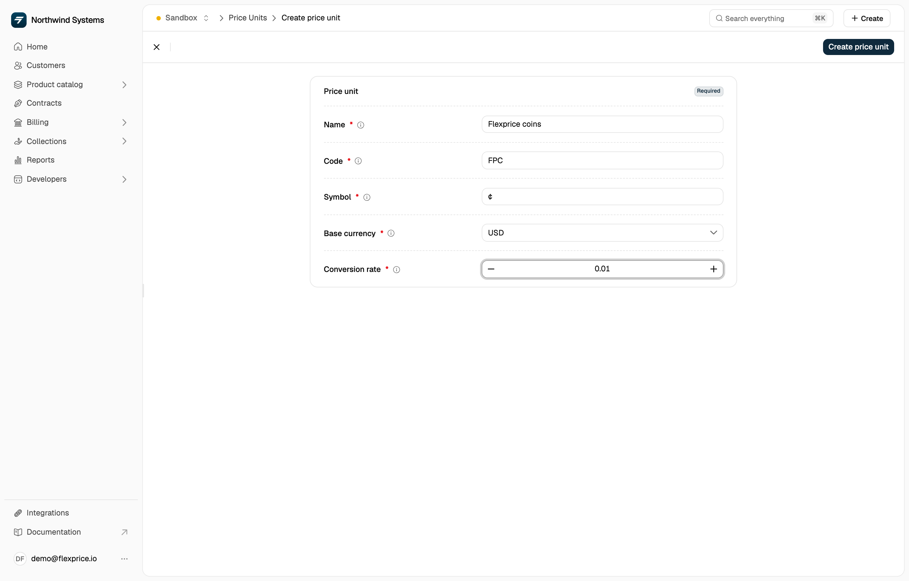

A pricing unit lets you price a charge in a unit of your own, such as credits or tokens, instead of a standard currency like USD or EUR. You set and show the price in the unit, for example 10 credits a month, and Flexprice converts the amount to the unit's base currency for billing. Accounting stays in one currency even though the charge reads in credits.

<Note>
  A pricing unit is not a [custom currency](/docs/product-catalogue/custom-pricing/custom-currency). A pricing unit applies to the single price or wallet that names it, and the price converts when it is created. A custom currency is defined once for the environment, and amounts stay in it until the invoice. To choose between them, see [Custom Pricing Use Cases](/docs/product-catalogue/custom-pricing/use-cases).
</Note>

## How conversion works

All billing calculations use the pricing unit's base currency, for example USD. You enter and see amounts in the pricing unit; Flexprice computes, stores, and invoices in the base currency. A price converts once, when it is created:

```text
amount in your unit × conversion_rate = amount in base currency
```

Rounding to the currency's precision (two decimals for USD, zero for JPY) is applied only when invoice charges are computed, not when a price or price unit is created.

A wallet created with a price unit takes the unit's base currency and conversion rate. Its balance shows in the base currency and in credits, like any other wallet.

## Use cases

- **Credits or tokens:** sell in credits or tokens, and show charges in that unit while billing in the base currency.
- **One unit across regions, one billing currency:** present prices in a unit of your own while keeping one base currency for accounting and payouts.

For step-by-step examples in the dashboard and the API, see [Pricing unit use cases](/docs/product-catalogue/custom-pricing/use-cases#pricing-unit-use-cases).

## Price unit fields

| Field | Description |
|-------|-------------|
| **code** | Three-character identifier, such as `CRD` or `TOK`, used when a price or wallet references the unit. Codes are case-sensitive and must be unique per environment while the unit is active. |
| **symbol** | Display symbol shown in the UI and on invoices, such as ¢. |
| **base_currency** | The standard currency the unit is pegged to, such as `usd`. All billing and storage use this currency. |
| **conversion_rate** | What one unit is worth in the base currency. |

**Example:** if 1 credit is worth 0.01 USD, set `conversion_rate` to `"0.01"`. Then 100 credits are 1.00 USD.

**Price unit types: FIAT and CUSTOM**

Every price sets `price_unit_type`:

- **FIAT:** amounts are in the price's `currency`, with no conversion. Prices in a custom currency also use `FIAT`.
- **CUSTOM:** amounts are in a price unit, set in `price_unit_config`. Flexprice converts them to the unit's base currency.

## Create a Price Unit (dashboard)

<Steps>
  <Step title="Open Price Units">
    Search for **Price Units** in **Search everything** (⌘K) and open it, then click **New price unit**.
  </Step>

  <Step title="Fill in the details">
    Enter **Name**, **Code** (three characters, such as CRD), **Symbol**, **Base currency**, and **Conversion rate**, then click **Create price unit**. For 100 units to 1 USD, use a conversion rate of **0.01**.
  </Step>
</Steps>

<Frame>
  
</Frame>

## Create a Price Unit (API)

Send `POST /v1/prices/units` with **name**, **code**, **symbol**, **base_currency**, and **conversion_rate**, and optionally **metadata**:

```json
{
  "name": "Credits",
  "code": "CRD",
  "symbol": "¢",
  "base_currency": "usd",
  "conversion_rate": "0.01",
  "metadata": {}
}
```

With this unit, 100 CRD are 1.00 USD. Send the request to your region's base URL: `https://us.api.flexprice.io/v1` (US), `https://api.cloud.flexprice.io/v1` (India), `https://canada.api.flexprice.io/v1` (Canada), or `https://eu.api.flexprice.io/v1` (EU). See [Create a price unit](/api-reference/price-units/create-price-unit) in the API Reference.

## Use the unit in plans and wallets

Once the unit is active, price plan charges in it from the dashboard or with `POST /v1/prices`, and create wallets valued in it with `POST /v1/wallets`. [Pricing unit use cases](/docs/product-catalogue/custom-pricing/use-cases#pricing-unit-use-cases) walks through each one, including the fields every billing model needs. For every price unit endpoint, see [Price Units](/api-reference/price-units/list-price-units) in the API Reference.
