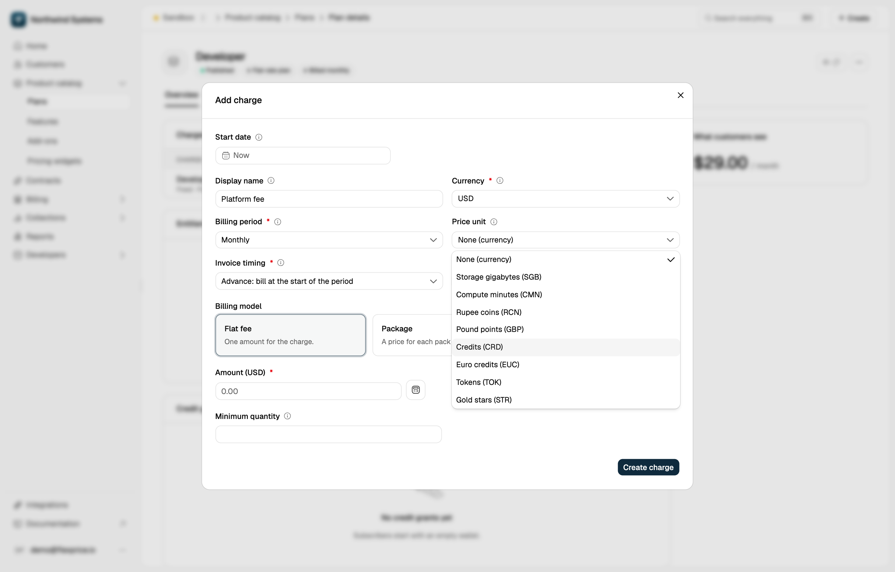
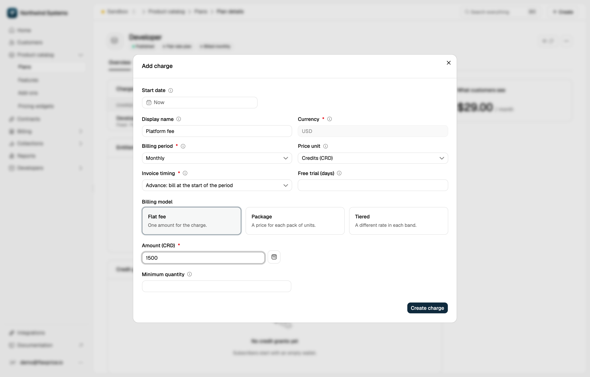

Flexprice offers two ways to price in a unit of your own, such as credits or tokens. A [pricing unit](/docs/product-catalogue/custom-pricing/pricing-unit) prices one charge or wallet in the unit and converts the amount to the unit's base currency. A [custom currency](/docs/product-catalogue/custom-pricing/custom-currency) is defined once for the environment: prices, subscriptions, wallets, and coupons created in it keep their amounts in that currency, and the invoice settles in fiat.

## Choose a pricing unit or a custom currency

| | Pricing unit | Custom currency |
|---|---|---|
| **Defined in** | **Price Units**, or `POST /v1/prices/units` | **Settings** → **Currency** → **Currencies**, or the `custom_currency_config` setting |
| **Used by** | A price or wallet that names the unit | Any price, subscription, wallet, or fixed-amount coupon whose `currency` is the custom code |
| **Converts to fiat** | When the price is created | When the invoice is computed |
| **Subscription currency** | The unit's base currency, such as `usd` | The custom code, such as `fpc` |
| **Invoice** | In the base currency | In fiat, with the custom-currency amounts kept in a `custom_currency` object |
| **Dashboard** | Add charges priced in the unit | Configure the currencies. Create prices and wallets in them through the API |

Use a pricing unit when one charge should read in credits while the plan, subscription, and invoice stay in fiat. Use a custom currency when the whole contract runs in your unit, including prepaid credits and fixed discounts.

## Pricing unit use cases

The examples use a price unit with code `CRD` (Credits), base currency `usd`, and conversion rate `0.01`, so 100 CRD is worth \$1.00. Create the unit first, as described in [Pricing Unit](/docs/product-catalogue/custom-pricing/pricing-unit).

### Price a plan charge in a unit from the dashboard

<Steps>
  <Step title="Add a charge to the plan">
    Open the plan and click **Add charge** in the **Charges** card. Choose **Fixed** for an amount per period or **Usage** to charge by usage, then click **Continue**.
  </Step>

  <Step title="Select the price unit">
    Expand **Advanced** and select the unit in **Price unit**, for example **Credits (CRD)**. The field appears once an active price unit exists. **Currency** then locks to the unit's base currency. Leave **None (currency)** selected to price in a standard currency such as USD or INR.
  </Step>

  <Step title="Enter the amount in the unit">
    Enter the amount in the unit, for example 1,500 credits a month. The field reads **Amount (CRD)**. Click **Create charge**.
  </Step>
</Steps>

<Frame>
  
</Frame>

<Frame>
  
</Frame>

### Price a plan charge in a unit with the API

Send `POST /v1/prices` with `price_unit_type` set to `CUSTOM` and the amount in `price_unit_config`. Set `currency` to the unit's base currency exactly as it is stored, here `usd`. Flexprice rejects a price whose currency differs from the unit's base currency.

```json
{
  "entity_type": "PLAN",
  "entity_id": "your-plan-id",
  "type": "FIXED",
  "billing_model": "FLAT_FEE",
  "billing_period": "MONTHLY",
  "invoice_cadence": "ADVANCE",
  "currency": "usd",
  "price_unit_type": "CUSTOM",
  "price_unit_config": {
    "price_unit": "CRD",
    "amount": "100.00"
  }
}
```

Flexprice stores 100 CRD on the price as 1.00 USD, keeps the CRD amount alongside it, and bills the USD amount. Each billing model takes these fields:

| Billing model | In `price_unit_config` | Also set |
|---|---|---|
| `FLAT_FEE` | `price_unit`, `amount` | |
| `PACKAGE` | `price_unit`, `amount` | `transform_quantity`, and `meter_id` for a usage charge |
| `TIERED` | `price_unit`, `price_unit_tiers` | `tier_mode`, and `meter_id` for a usage charge. Leave out the top-level `tiers` |

### Create a wallet valued in a unit

Create the wallet through the API, since the dashboard's wallet form lists standard currencies only. Send `POST /v1/wallets` with `price_unit` set to the unit's code:

```json
{
  "customer_id": "your-customer-id",
  "currency": "usd",
  "price_unit": "CRD",
  "wallet_type": "PRE_PAID"
}
```

Flexprice sets the wallet's currency and conversion rate from the unit and ignores any `conversion_rate` in the request. `currency` is still required. A code that matches no active price unit returns a 404. With the example unit, one wallet credit is worth 1 CRD, which is \$0.01.

The wallet keeps no link to the unit. It is a wallet in the base currency, so it counts toward the customer's limit of one active wallet per currency and wallet type. Its balance shows in the base currency and in credits, like any other wallet.

## Custom currency use cases

The examples use a custom currency with code `fpc` (FinePrint Credits) worth \$0.10, and `usd` as the settlement currency. Configure the currency first, in the dashboard or through the API, as described in [Custom Currency](/docs/product-catalogue/custom-pricing/custom-currency#configure).

<Warning>
  Once any custom currency is configured, every new price, subscription, wallet, and fixed-amount coupon must use a configured custom currency or a fiat currency that the custom currencies quote. Flexprice rejects any other currency.
</Warning>

### Price a plan in a custom currency

Create each price through the API with `currency` set to the custom code. The dashboard's **Add charge** form lists standard currencies only. `price_unit_type` stays `FIAT`, because a custom currency is a currency, not a price unit.

```json
{
  "entity_type": "PLAN",
  "entity_id": "your-plan-id",
  "type": "USAGE",
  "meter_id": "your-meter-id",
  "billing_model": "FLAT_FEE",
  "billing_period": "MONTHLY",
  "invoice_cadence": "ARREAR",
  "currency": "fpc",
  "price_unit_type": "FIAT",
  "amount": "2"
}
```

This charges 2 FPC for every unit the meter records. Every billing model works the same way, with its amounts in FPC. A plan can hold prices in a custom currency and in fiat side by side, and each subscription bills only the prices in its own currency.

### Subscribe a customer in a custom currency

Create the subscription with `currency` set to the custom code. Flexprice attaches only the plan's prices in that currency. If the plan has none, the request fails with `No prices match the subscription criteria`.

```json
{
  "customer_id": "your-customer-id",
  "plan_id": "your-plan-id",
  "currency": "fpc",
  "billing_period": "MONTHLY"
}
```

In the dashboard, the subscription form offers the currencies the plan has prices in. If the customer has a billing currency other than the settlement currency, the custom currency needs a conversion factor for that billing currency, or the subscription is rejected.

### Sell prepaid credits in a custom currency

Create a prepaid wallet through the API with `currency` set to the custom code:

```json
{
  "customer_id": "your-customer-id",
  "currency": "fpc",
  "conversion_rate": "1",
  "wallet_type": "PRE_PAID"
}
```

`conversion_rate` is what one credit is worth in the wallet's currency, so here one credit is 1 FPC. The credits apply only to invoices in the same custom currency, so a `usd` wallet never pays an `fpc` invoice. A purchased top-up is invoiced like any other charge: in fiat, with the FPC amounts kept in the invoice's `custom_currency` object.

### Discount a custom-currency subscription

A fixed-amount coupon applies only to subscriptions in the coupon's currency. To take 50 FPC off, create a coupon with `type` set to `fixed`, `amount_off` set to `50`, and `currency` set to `fpc`. Percentage coupons apply in any currency. Flexprice computes the discount in FPC, before the invoice converts to fiat.

### Read both amounts on an invoice

A subscription in a custom currency is invoiced in the customer's billing currency when it has one, otherwise in the settlement currency (`default_fiat_currency`). The invoice's `custom_currency` object keeps the subtotal, discount, tax, prepaid credits, total, and amount due in your currency, and each line item keeps its own amounts the same way.

- **Rate:** the conversion factor is recorded on the invoice and frozen when the invoice is finalized. Changing the factor later does not change finalized invoices.
- **Tax:** calculated in fiat, then restated in your currency in the `custom_currency` object.
- **Payments:** recorded and collected in the invoice's fiat currency.

The dashboard shows the fiat amounts. Read the custom-currency amounts from the API, as in the example in [Custom Currency](/docs/product-catalogue/custom-pricing/custom-currency#invoicing).
